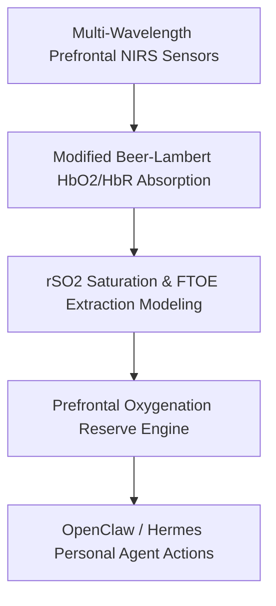

# Frontal Cerebral Regional Tissue Oxygenation (NIRS rSO2) Skill

[](LICENSE)
[](https://www.python.org/)
[](requirements.txt)
[](mcp_server.py)
[](SKILL.md)

Zero-dependency sovereign personal agent skill for non-invasive calculation of frontal cerebral tissue oxygen saturation (rSO2), Fractional Tissue Oxygen Extraction (FTOE), and cognitive endurance kinetics.



## Features
- **Deterministic Math**: Pure Python standard library implementation with zero external dependencies.
- **NIRS Standard Equations**: Implements validated spectroscopic equations for regional cerebral oxygenation.
- **Cognitive Exhaustion Stratification**: Quantitative evaluation of microvascular supply vs demand in intense work.
- **Model Context Protocol (MCP)**: Native JSON-RPC tool integration for LLMs and autonomous agents.

## Quickstart

```python
from client import CerebralTissueOxygenationClient

client = CerebralTissueOxygenationClient()
result = client.evaluate_cerebral_oxygenation(
    frontal_rso2_pct=69.5,
    systemic_spo2_pct=99.0,
    baseline_rso2_pct=70.0
)
print("Frontal rSO2:", result["frontal_rso2_pct"], "%")
print("Classification:", result["classification"])
```

## License
Apache-2.0
